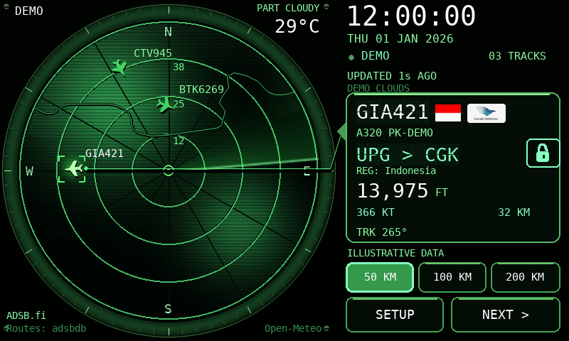
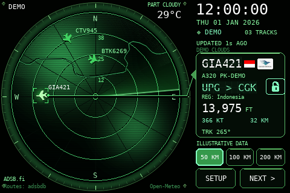

# RADARpi

A green radar display built and tested on **Raspberry Pi 3 Model B (Pi 3B)**: live aircraft, callsigns and routes,
offline coastlines, infrared satellite imagery, and local weather.
Built with Python and pygame; no browser or ADS-B receiver is required.
Aircraft positions come from internet data providers.

## Screenshots

These screenshots were rendered on Raspberry Pi 3B hardware using **illustrative
sample data** and a generic public city-centre location. Aircraft positions,
weather and cloud shapes are demonstrations, not live observations. No personal
configuration, Wi-Fi information or device addresses are included.

**5-inch HDMI display — 800 × 480**



**3.5-inch SPI display — 480 × 320**



## Tested hardware

Both physical builds use a **Raspberry Pi 3B** with microSD storage, Wi-Fi and
an appropriate power supply.

| Build | Display | Touch |
| --- | --- | --- |
| 5-inch | HDMI, 800 × 480 | GPIO XPT2046/ADS7846-compatible resistive touch |
| 3.5-inch | SPI ILI9486, 480 × 320 | ADS7846-compatible resistive touch |

Display drivers and calibration depend on the specific LCD. Screen size alone
does not identify the controller. Other resolutions have software layout checks;
they are not a claim that every panel has been physically tested.

A custom 3D-printed desktop enclosure has also been built. Its design files are
not included in this repository yet.

## Features

Callsigns and known routes use a Solari-style split-flap transition when
they change. Each changing position cycles through 8–11 flaps and settles within
about three seconds; unchanged text stays still. Unknown routes display dashes. Both display versions cache glyphs, text measurements and finished boards,
and animate locally without extra
network requests.

Use **SETUP → Display / units → Contrast** to choose Normal, Medium, High,
or Maximum with a live preview. The setting saves independently on each Pi.
This adjusts radar colors, not the LCD backlight; Normal preserves the original
palette. On both display versions, higher contrast also strengthens the cloud layer
while preserving transparent areas. Cached colors keep full-screen filters out of the animation loop.

Three range buttons on the radar select **50, 100 or 200 km** directly.
The current range is highlighted; Imperial mode shows equivalent miles.

Tap the padlock beside the route to hold the selected aircraft. Tap it again
to resume automatic cycling. Selecting another aircraft, including with NEXT,
releases the lock.
If the locked aircraft disappears, the panel waits for it; locks reset on restart.

## Choose your display version

| Version | Location | Intended display |
| --- | --- | --- |
| Native-resolution UI | Repository root | HDMI/KMS panels, including 800×480, 1024×600 and 1280×800 |
| Working SPI version | [`spi-480x320/`](spi-480x320/) | 480×320 ILI9486 LCD with ADS7846-compatible resistive touch |

The main version draws fonts, controls, aircraft and coastlines at the selected
pixel density. Wide panels gain a wider information panel. Taller aspect ratios
retain a centred landscape layout. Satellite imagery retains its source resolution.
The sweep cache is capped at 64 MiB.

The versions are separate snapshots so the existing SPI installation can retain
its display backend. Do not replace SPI drivers or boot configuration with HDMI settings.

## Quick start

Start with a working display driver and an internet connection. The tested
hardware uses Raspberry Pi OS/Debian Trixie on a Raspberry Pi 3B. Other panels
need their own appropriate display and touch drivers.

```sh
sudo apt update
sudo apt install git python3 python3-pygame python3-numpy libdrm2 network-manager
git clone https://github.com/japri/RADARpi.git
cd RADARpi
cp config.example.json config.json
python3 display_settings.py
python3 radar.py --windowed --resolution 800x480
```

The example location is **0°, 0°**. Set your location through **SETUP → Radar
location**, or edit `latitude` and `longitude` in `config.json` before starting.
Never overwrite an existing configuration or touch calibration during upgrades.

For direct HDMI/KMS output, run from a local console with the desktop display
session stopped and access to the `video`, `render` and `input` devices:

```sh
python3 start-hdmi.py --fps 20
```

Use `--rotate-display 180` for an upside-down enclosure. Other supported rotations
are 0, 90 and 270. Add `--raw-touch` only for a configured ADS7846/XPT2046 GPIO
touchscreen; calibrate using **SETUP → Calibrate touch**. USB/SDL touch uses the
normal pointer path. These commands do not configure hardware overlays.

### Resolution selection

```sh
python3 display_settings.py                       # Interactive chooser
python3 display_settings.py --resolution auto     # Active display mode
python3 display_settings.py --resolution 800x480  # Save an explicit choice
python3 radar.py --resolution 1024x600             # One-run override
```

Choose the panel's actual pixels, not its diagonal size. A 5- or 7-inch display
may use different resolutions. Selection is saved in `display.json`; the driver
must support the requested mode. See [display setup notes](DISPLAY-SETUP.txt).

## 3.5-inch SPI display

The separate version requires an already configured **ILI9486 DRM driver** and
ADS7846-compatible touch input. It is not a universal installer for every 3.5-inch LCD.

```sh
cd spi-480x320
cp config.example.json config.json
python3 radar.py --windowed
# With the desktop stopped and the appropriate device permissions:
python3 radar.py --native-drm --rotate-display 180 --fps 12
```

The direct SPI backend is fixed to 480×320 and uses the tested 180-degree
orientation. Calibrate on the individual device. Its configuration and calibration
are independent from the main application.

## Controls and information

- **RANGE:** change the radius; **NEXT:** select another aircraft.
- **SETUP:** location, data provider, polling interval, callsign labels, clouds,
  display units and touch calibration. Keyboard shortcuts: **S**, **N**, **Esc**.
- **SETUP → Display / units:** Aviation (ft / kt / km), Metric (m / km/h / km),
  or Imperial (ft / mph / mi). Temperature remains an independent choice.
  Changes save immediately and do not change feed units or radar coverage.
- Altitude and ground speed follow your selected units. Distance is the ground
  distance from the selected aircraft to your configured radar centre.
- A small flag beside the selected callsign uses the same inferred registration
  state. Flag assets are bundled offline; unknown states show no flag.
- Where available, an airline logo follows the flag, matched from the ICAO
  callsign prefix. Logos are bundled offline. Missing logos and registrations
  show no airline badge. This prefix match is an inference, not verified ownership.
  On the small LCD, compact badges and a smaller callsign font are used when
  necessary; text-heavy logos may be difficult to read.
- **REG:** registration state inferred offline from the ICAO address allocation;
  not the aircraft's departure airport. Unknown/unallocated addresses show Unknown.
- **HDG xxx°T/M:** reported true/magnetic heading. **TRK xxx°:** ground track
  when no heading is reported. Missing direction is shown as `HDG --`.
- Weather conditions sit above temperature. Infrared imagery shows its source,
  observation time and age; old imagery is explicitly labelled.

Wi-Fi status uses NetworkManager on `wlan0`. In-app Wi-Fi scanning/connection
requires the optional [network helper setup](docs/network-helper.md). Without it,
configure Wi-Fi through Raspberry Pi OS or `nmcli`.

## Data sources

Aircraft providers: ADSB.fi and ADSB.lol. Poll intervals and server retry limits
are respected. Route lookup is best effort; unknown routes remain marked unknown.
Aircraft motion between reports is estimated and limited to 30 seconds.

- [Aircraft provider notes](FREE-ADSB-PROVIDERS.txt)
- [NASA GIBS / EUMETSAT imagery notes](CLOUD-SOURCES.txt)
- [Open-Meteo weather notes](WEATHER-SOURCE.txt)
- [Natural Earth coastline attribution](COASTLINE-SOURCE.txt)
- [Offline registration-state data and attribution](COUNTRY-DATA-SOURCE.txt)
- [Flag images from Flagpedia.net / FlagCDN](FLAGS-SOURCE.txt)
- [Airline logo collection and source notes](AIRLINE-LOGOS-SOURCE.txt)

Service availability, coverage and usage terms belong to the respective providers.
This is a hobby display, not an aviation navigation or flight-weather instrument.

## Validation and performance

```sh
python3 -m unittest discover -v
cd spi-480x320
python3 -m unittest discover -v
```

The main version has been physically run at 800×480 on a Pi 3B, at approximately
16–17 FPS under the observed load. Software layout checks covered 480×320,
800×480, 1024×600, 1024×768, 1280×800, 1920×1080 and rotated output.
Those checks do not certify every panel or driver. Higher resolutions cost more
CPU; the SPI version has its own bandwidth limits.

Only application code, sample settings and source attribution are included.
Personal configurations, credentials, device addresses, calibration files,
deployment scripts, backups and live diagnostic images are excluded. Only the
labelled sample-data screenshots in `docs/images/` are published.


## License

RADARpi application code is licensed under the **GNU General Public License
version 3 only** (`GPL-3.0-only`). Copyright (C) 2026 japri.
See [LICENSE](LICENSE) for the complete terms. The standalone SPI directory
also includes a copy of the license.

You may use, modify and redistribute the code, including commercially, under
GPLv3. When distributing covered software, comply with its license-notice and
corresponding-source requirements. The software is provided without warranty;
see the license for details.

Third-party assets retain their own terms; this GPL notice does not relicense
those assets or grant rights to airline trademarks:

- Registration data: [source](COUNTRY-DATA-SOURCE.txt) and [CC0 license](COUNTRY-DATA-LICENSE.txt).
- Coastlines: [Natural Earth attribution](COASTLINE-SOURCE.txt).
- Flags: [source notes](FLAGS-SOURCE.txt).
- Airline logos: [source and trademark notes](AIRLINE-LOGOS-SOURCE.txt), with upstream notices in the archive.
- External services: [aircraft](FREE-ADSB-PROVIDERS.txt), [cloud imagery](CLOUD-SOURCES.txt), and [weather](WEATHER-SOURCE.txt) terms still apply.

Enclosure design files are not included and are not licensed by this code notice.
